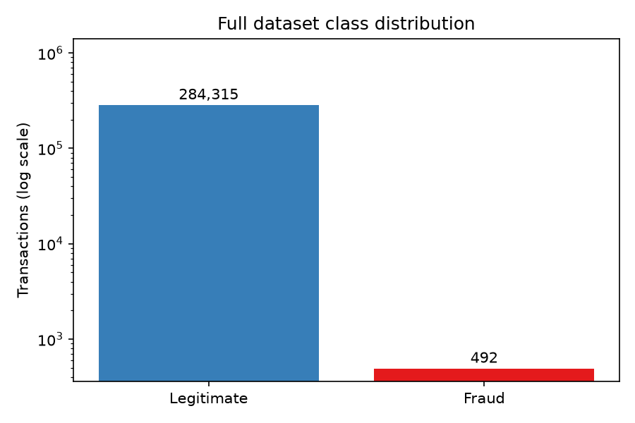
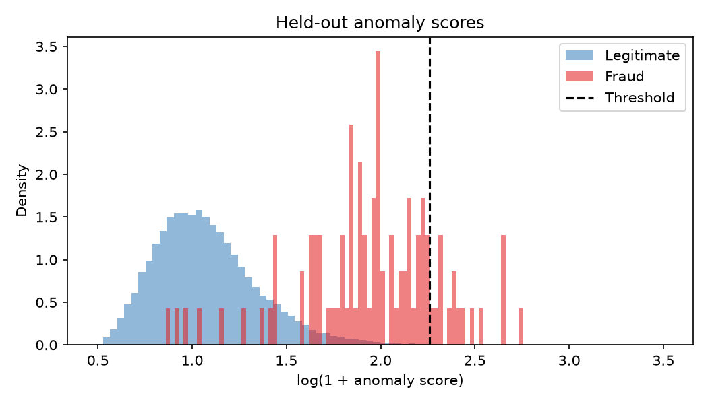
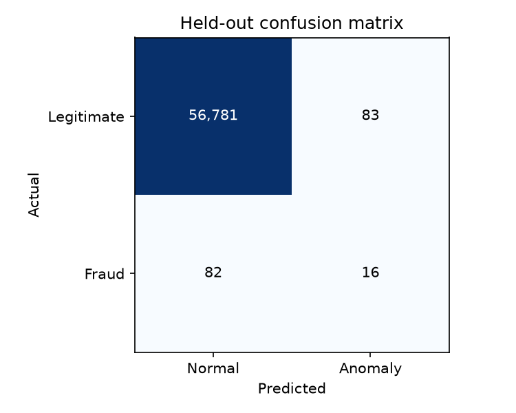
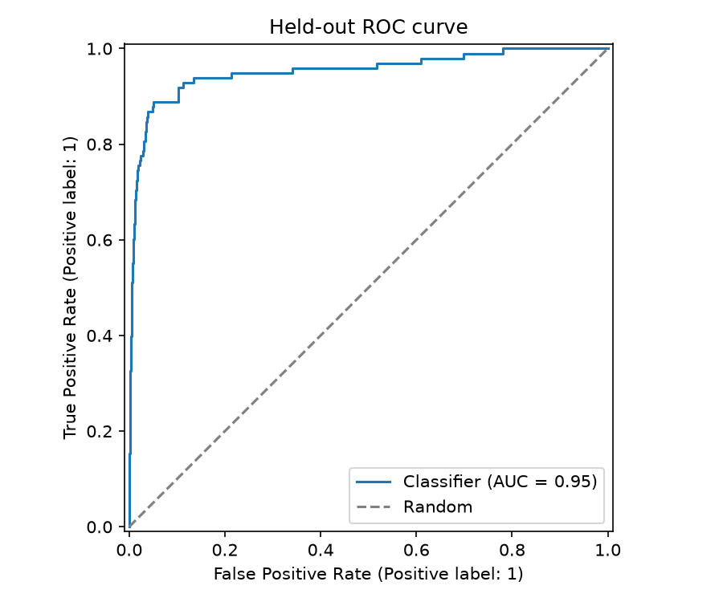
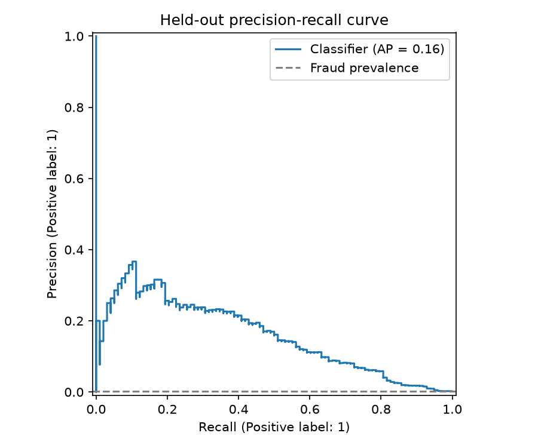

# MSCS633 Assignment 4: Fraud Detection with PyOD AutoEncoder

## Overview and objective

This experiment uses the PyOD PyTorch AutoEncoder to identify unusually reconstructed credit-card transactions. The primary experiment is unsupervised: `Class` is excluded from all 30 inputs and no labels are passed to `fit`. Labels are used to stratify the benchmark split and evaluate held-out results. Higher reconstruction-based anomaly scores mean more unusual, not a probability of fraud.

## How the AutoEncoder works

Input → encoder → compressed representation → decoder → reconstruction → reconstruction error → anomaly score. The model learns to reconstruct training transactions; observations with large reconstruction errors can be flagged as outliers. An outlier is not necessarily fraudulent.

## Dataset

The [Kaggle credit-card fraud dataset](https://www.kaggle.com/datasets/mlg-ulb/creditcardfraud) contains transactions from a historical two-day period. The local CSV was verified to contain 284,807 transactions, including 284,315 legitimate and 492 fraudulent (0.1727%). It has `Time`, `Amount`, 28 anonymized PCA-transformed features (`V1`–`V28`), and `Class`. Labels are not features. Validation rejects schema, count, numeric, missing-value, infinity, and class errors; no rows are silently dropped.

## Why accuracy is misleading

Predicting every transaction as legitimate would be about 99.8% accurate yet detect no fraud. Precision, recall, F1, average precision and the confusion matrix provide more useful context for this rare class.

## Project structure

- `run_experiment.py`: command-line entry point.
- `fraud_detection/`: configuration, validation, scaling, model, evaluation and plotting.
- `data/`: dataset instructions and local-only CSV.
- `tests/`: fast synthetic tests.
- `outputs/`: full-run results; `outputs/quick/` is ignored development output.
- `docs/screenshots/`: authentic experiment screenshots.
- `requirements.txt`, `MANIFEST.in`, `pyproject.toml`: dependencies and packaging.

## Prerequisites and installation

Python 3.11, macOS, Windows or Linux. Apple Silicon MPS acceleration is optional when PyTorch reports it available; CPU is supported. From the repository root (on Windows use `.venv\\Scripts\\activate`):

```bash
cd "/Users/ashishmahajan/WorkSpace/MS_UC/Advance Artificial Intelligence/MSCS633_Assignment_4_Unsupervised_AL"
python3.11 -m venv .venv
source .venv/bin/activate
python -m pip install --upgrade pip
python -m pip install -r requirements.txt
python -m pip check
```

## Dataset setup

Place the original Kaggle `creditcard.csv` in `data/`. The data and local ZIP are excluded from Git; the program does not download data. See [data/README.md](data/README.md).

## Run the full experiment

```bash
python run_experiment.py
```

The default auto device selects MPS when available, otherwise CPU. Override with `--device cpu` or `--device mps`; explicitly requested unavailable MPS fails with a clear error. `--data PATH`, `--epochs N`, and `--batch-size N` are also supported. Defaults use all 284,807 rows and 20 epochs.

## Optional comparison

```bash
python run_experiment.py --compare-normal-only
```

The normal-only reference uses labels to select legitimate training rows. It is a one-class, label-assisted comparison, not the primary unsupervised model. Both models use the same test partition and scaler fit on the complete training partition. Separate `normal_only_` figures and entries make the comparison explicit.

## Quick development run

```bash
python run_experiment.py --quick
```

Quick mode uses a stratified 20,000-row subset after validating the full CSV and writes to `outputs/quick/`. **FINAL SUBMISSION RESULTS MUST COME FROM THE FULL DATASET RUN.**

## Model configuration and evaluation

The deterministic 80/20 stratified split uses seed 42. `StandardScaler` is fit only on training features, then transforms both partitions. PyOD internal preprocessing is disabled. The AutoEncoder uses hidden layers `[64, 32]`, ReLU, batch normalization, dropout 0.2, learning rate 0.001, batch size 256, and 20 epochs. The contamination prior is 492/284807, reflecting published prevalence; PyOD uses it to derive a threshold from training scores, not from test labels. Test ROC-AUC and average precision use continuous scores; precision, recall, F1 and the confusion matrix use predictions from that training-derived threshold.

Precision is the fraction of alerts that are fraud; recall is the fraction of frauds detected; F1 balances those two. ROC-AUC measures ranking across false-positive rates; average precision summarizes the precision-recall curve and is useful for rare frauds. Average precision is not trapezoidal PR curve area.

## Results

The full 20-epoch MPS run used 227,845 training and 56,962 test transactions (98 frauds). The primary unsupervised model obtained ROC-AUC **0.9546**, average precision **0.1568**, precision **0.2447**, recall **0.2347**, and F1 **0.2396** at the training-derived threshold **8.945906**. The confusion matrix was TN=56,793, FP=71, FN=75, TP=23; 94 transactions were flagged. Stronger ranking performance does not imply high recall at this threshold: 75 of 98 frauds were missed. Exact values and runtime are in [metrics.json](outputs/metrics.json).

In a separate CPU comparison run on the same split, the **normal-only reference**, which uses labels to select training examples, obtained ROC-AUC **0.9595**, average precision **0.6197**, precision **0.4188**, recall **0.8163**, and F1 **0.5536**; TN=56,753, FP=111, FN=18, TP=80, with 191 alerts. It is a different, label-assisted experiment and produced 28 more false positives than that run’s CPU primary model. Both CPU comparison results are retained in [metrics_comparison.json](outputs/metrics_comparison.json). Results may differ between CPU and MPS runs.

## Visual results







## Responsible Use and Limitations

An anomaly is not proof of fraud: reconstruction error measures unusualness, not guilt or intent. False positives can inconvenience legitimate customers; false negatives can let fraud through. This model should support investigation, not automatically punish or block customers without appropriate review. High-impact use requires validation, monitoring and human review, with attention to rare-class errors rather than overall accuracy. This historical dataset may not represent future behavior; concept drift can degrade performance. Anonymized PCA features limit explainability. Protected demographic attributes are unavailable, so demographic subgroup fairness cannot be meaningfully measured here. Chapter 27's bias concerns motivate scrutiny beyond aggregate metrics; this experiment evaluates class imbalance and detection errors, not demographic fairness.

## Testing

```bash
python -m pytest -v
python -m compileall fraud_detection run_experiment.py
```

## Assignment deliverables

Python source, tests, `requirements.txt`, and `MANIFEST.in` are in this repository. Authentic experiment screenshots are stored in `docs/screenshots/`; the completed-run screenshot is included in the separately prepared Word document for Blackboard. The plots and `outputs/metrics.json` are generated by the experiment. The top-anomaly CSV includes `Class` only after scoring for evaluation; row indices refer to the original CSV.

## GitHub repository

https://github.com/AshishM26/MSCS633_Assignment_4_Unsupervised_AL

## Author and course

Ashish Bhanudas Mahajan, MSCS-633 Advanced Artificial Intelligence, University of the Cumberlands

## References

- [PyOD documentation: AutoEncoder](https://pyod.readthedocs.io/en/latest/pyod.models.html#module-pyod.models.auto_encoder)
- [PyOD source code](https://github.com/yzhao062/pyod)
- [Machine Learning Group, ULB: Credit Card Fraud Detection dataset](https://www.kaggle.com/datasets/mlg-ulb/creditcardfraud)
- [scikit-learn: average precision](https://scikit-learn.org/stable/modules/generated/sklearn.metrics.average_precision_score.html)
